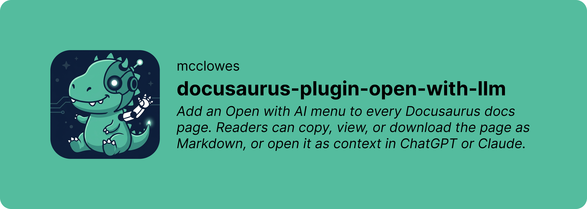

# Docusaurus plugin open with LLM

Add an **Open with AI** menu to every Docusaurus docs page. Readers can copy, view, or download the page as Markdown, or open it as context in ChatGPT or Claude.

The plugin supplies the UI and theme integration. Your site must also publish a Markdown version of each page at `<docs-route>/index.md`, or at the relative filename you configure with `markdownFile`.

## Install

```sh
npm install docusaurus-plugin-open-with-llm
```

Add the plugin to `docusaurus.config.js` or `docusaurus.config.ts`:

```js
export default {
  plugins: ['docusaurus-plugin-open-with-llm'],
}
```

That's enough to add the menu to docs pages. The default actions are:

- Copy as Markdown
- View as Markdown
- Download as Markdown
- Open in ChatGPT
- Open in Claude

## Publish Markdown pages

The menu fetches a static Markdown file matching the current docs route. For example:

```text
Docs page:       https://example.com/guides/payments/
Markdown source: https://example.com/guides/payments/index.md
```

Use a Docusaurus Markdown export plugin or your own build step to create those files. This plugin deliberately doesn't generate Markdown, so it works with whichever exporter already owns that job in your site.

If your exporter uses another filename, set `markdownFile`:

```js
export default {
  plugins: [
    [
      'docusaurus-plugin-open-with-llm',
      {
        markdownFile: 'page.md',
      },
    ],
  ],
}
```

## Configure the menu

```js
export default {
  plugins: [
    [
      'docusaurus-plugin-open-with-llm',
      {
        buttonLabel: 'Ask an LLM',
        prompt: 'Use {url} as context, then help me understand it.',
        providers: [
          {
            label: 'Open in ChatGPT',
            url: 'https://chatgpt.com/?q={prompt}',
          },
          {
            label: 'Open in Claude',
            url: 'https://claude.ai/new?q={prompt}',
          },
          {
            label: 'Open in Perplexity',
            url: 'https://www.perplexity.ai/search?q={prompt}',
          },
        ],
      },
    ],
  ],
}
```

| Option         | Type                | Default                                                     | Purpose                                                         |
| -------------- | ------------------- | ----------------------------------------------------------- | --------------------------------------------------------------- |
| `enabled`      | `boolean`           | `true`                                                      | Disable the widget without removing the plugin.                 |
| `buttonLabel`  | `string`            | `"Open with AI"`                                            | Set the trigger button text.                                    |
| `markdownFile` | `string`            | `"index.md"`                                                | Set the relative Markdown filename appended to each docs route. |
| `prompt`       | `string`            | `"Read {url} and answer my questions using it as context."` | Set the provider prompt. It must contain `{url}`.               |
| `providers`    | `ProviderOptions[]` | ChatGPT and Claude                                          | Replace the provider links. Each URL must contain `{prompt}`.   |

Setting `providers` to an empty array leaves only the copy and view actions.

## Use the component directly

The plugin automatically wraps `DocItem/Layout`. If your site already supplies that theme component, the last plugin to register the same theme path wins. Import the widget and place it in your existing wrapper instead:

```tsx
import OriginalLayout from '@theme-original/DocItem/Layout'
import { OpenWithLlm } from 'docusaurus-plugin-open-with-llm/client'

export default function DocItemLayout(props) {
  return (
    <>
      <OpenWithLlm />
      <OriginalLayout {...props} />
    </>
  )
}
```

Keep the plugin in `plugins` when using the component directly. It provides the resolved client configuration.

## Development

```sh
npm install
npm test
npm run typecheck
npm run lint
npm run build
npm run test:package
```

Run the example Docusaurus site with:

```sh
npm run example:start
```

For a dependency-free visual preview of the widget, run `npm run preview:start` and open `http://127.0.0.1:4173`.

## License

MIT
